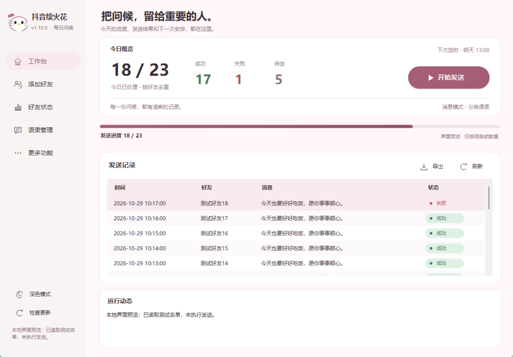
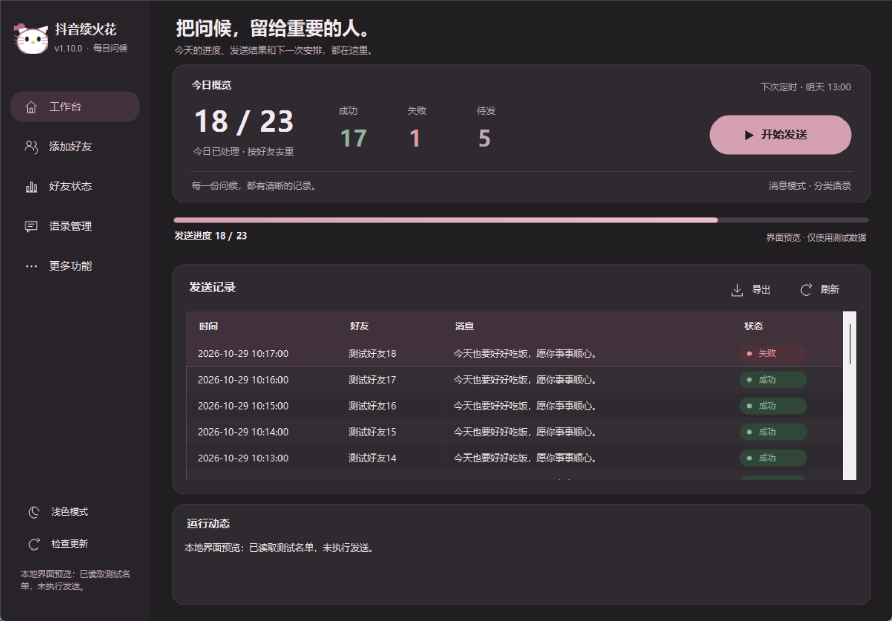

# 抖音续火花 · douyin-spark

Windows 桌面助手，C# WinForms 界面配合 Playwright，管理好友并发送自己配置的问候消息。当前版本 **v1.10.0**。

## 界面预览

奶白与低饱和粉为默认外观，也可在左下角切换深色模式。截图中的18/23及好友均为测试数据。





## 便携版使用

1. 从 [GitHub Releases](https://github.com/kai666yz/douyin-spark/releases/latest) 下载 Windows x64 ZIP，完整解压。
2. 双击 `抖音续火花.exe`，保留旁边的整个 `spark_backend` 文件夹。
3. 在“更多功能 → 浏览器选择”中选择已安装的 Edge、Chrome 或夸克。
4. 使用“更多功能 → 登录自检”扫码登录，再通过“添加好友”勾选导入关注列表，或在“管理好友”中填写主页链接。
5. 预览消息、核对名单后开始发送。新包好友名单为空，没有作者的登录状态或私人记录。

便携包已含独立 Python/Playwright 后端，无需另装 Python、豆包或下载 Playwright 浏览器内核。需要 Windows 10/11、.NET Framework 4.x（推荐4.8）及上述已安装浏览器之一。

旧版迁移时先退出旧程序，保留自己的 `friends.json`、`config.json`、对应 `browser_profile*` 和 `logs`，复制到新版目录。不要用下载包的空名单覆盖自己的名单。

## 功能与入口

| 功能 | 入口与行为 |
|---|---|
| 添加好友 | “添加好友”导入关注列表；“更多功能 → 管理好友”手动添加、粘贴个人主页短链、删除 |
| 今日概览 | 顶部查看已处理、成功、失败、待发、待确认与下次定时；按每位好友最后一次结果统计 |
| 外观 | 左下角浅色/深色开关，自动保存；窗口变小时优先保留主要操作与历史 |
| 好友状态 | 查看今天的状态；缺失主页显示“待补”，不会猜测链接 |
| 语录管理 | 勾选分类、编辑自定义语录；支持旧句子库格式与节日优先 |
| 固定消息 | “更多功能 → 固定消息设置”；留空恢复语录池，保存后对手动和定时任务生效 |
| 定时与自启 | 程序运行且电脑唤醒时按设定时间执行；开机自启使用 `--minimized` |
| 托盘 | 最小化或关闭窗口后继续在托盘运行；右键托盘选择“退出” |
| 历史 | 表格显示最近活动记录；更多功能中导出全部 CSV、清理旧历史 |
| 检查更新 | 查询 GitHub Releases；确认后打开官方下载页，手动更新 |

固定消息绕过语录池和“最近7天句子不重复”，**仍保留当天好友去重**。无需修改句子库，也无需删除日志。历史清理会先备份并保留今天的记录，避免清理历史后重复发送。

## 命令行

在解压目录打开 PowerShell：

```powershell
# 仅预览固定消息；不启动浏览器，不发送。
.\spark_backend\spark_backend.exe --dry-run --message "嘎嘎地拉下"

# 真正发送前，先核对好友和消息。省略 --dry-run 才会执行发送。
.\spark_backend\spark_backend.exe --message "自己填写的问候消息"

# 打开浏览器进行登录检查；不会发送消息。
.\spark_backend\spark_backend.exe --selftest

# 仅用本地 HTML 检查浏览器运行环境，不访问抖音。
.\spark_backend\spark_backend.exe --runtime-check

# 导出历史，不执行发送。
.\spark_backend\spark_backend.exe --export-history ".\发送历史.csv"
```

源码运行时将上面的后端命令改为 `.\.venv\Scripts\python.exe .\douyin_spark.py`，参数相同。`--friend` 可筛选好友；`--force` 明确忽略当天好友去重，用于人工决定的重发。`--cancel-file PATH` 指定的文件出现后会停止后续处理。

## 稳定性与数据保护

- 好友名单使用 JSON 读写，保存时原子替换并保留 `.bak`，支持 BOM 与尾逗号。损坏文件会报错并保留原文。
- CSV 活动日志保留最近14天，其余按月放入 `logs/archive/spark_log`。语录去重和导出仍读取归档。
- 文本日志每份最多约2 MiB，再轮换至 `.1`～`.5`。运行输出在下一次启动时重置。
- 检测到验证码时暂停，提示在浏览器手动处理，最多等待5分钟；页面提示操作频繁时停止任务。
- 未提交失败最多额外重试2次，分别退避2、4秒并重建页面；不切换 UA 或自动解验证码。
- 按下发送键前写入待确认记录；结果不确定时保留 `UNCONFIRMED`，不会自动重发，当天默认跳过该好友。
- 任务锁防止多个发送/导入任务占用同一目录。网站变化、网络及账号状态仍可能影响识别；应核对异常记录。

`friends.json`、配置、关注列表、浏览器登录状态、日志、备份和运行环境均在 `.gitignore` 中。自定义语录存放在句子库中，提交修改前须自行检查；发布脚本会清空“自定义”分类。

## 从源码构建

安装 Python 3.10+ 并加入 PATH，在仓库目录运行：

```powershell
powershell -ExecutionPolicy Bypass -File .\setup.ps1
powershell -ExecutionPolicy Bypass -File .\build.ps1
.\抖音续火花.exe
```

界面先寻找随包独立后端；未找到时依次使用 `.venv`、`DOUYIN_SPARK_PYTHON` 指定路径、便携 `runtime`、系统 PATH，最后才兼容查找当前用户的豆包沙箱。不存在固定用户名或沙箱版本路径。

生成可分发 ZIP：

```powershell
powershell -ExecutionPolicy Bypass -File .\package.ps1
```

输出在 `dist/douyin-spark-v1.10.0-windows-x64.zip`。使用 PyInstaller 文件夹模式，附带必要依赖与许可证；不直接复制本机 `.venv`。

## 源码结构

```text
src/app.cs              主窗口、定时与运行状态
src/FriendsForm.cs      好友管理与关注导入
src/Storage.cs          JSON、CSV与文本日志
src/BackendLauncher.cs  后端选择与进程启动
src/DesktopFeatures.cs 托盘、固定消息、历史和更新检查
src/Theme.cs            Kitty绘制
src/Appearance.cs       明暗配色、圆角与矢量图标
src/MainView.cs         仪表盘布局与数据刷新
src/DashboardCards.cs  概览和空状态卡片
src/TodaySummary.cs    今日去重统计
src/SparkProgress.cs    进度与完成动画
src/Controls.cs         其他自绘控件
douyin_spark.py         消息流程与命令行参数
fetch_following.py      关注列表读取
spark_support.py       路径、归档、任务锁、人工验证支持
spark_backend.py       独立后端入口
tests/                 离线回归测试
tools/package_release.py 发布打包
```

离线测试：`python -m unittest discover -s tests -p "test_*.py"`。C#存储测试见 `tests/StorageTests.cs`，需与 `src/Storage.cs` 一同编译为控制台程序。

## 许可证

原创代码采用 [MIT](LICENSE)。第三方依赖按各自许可证分发；Hello Kitty 等名称、形象及相关素材权利归各自权利人，MIT 不授予这些权利。本项目与抖音及相关品牌无隶属关系。请仅向愿意接收消息的好友使用。

本版已进行离线测试、界面渲染及独立后端本地浏览器检查；未进行真实消息发送或在线验证码验证。变更见 [CHANGELOG](CHANGELOG.md)。
