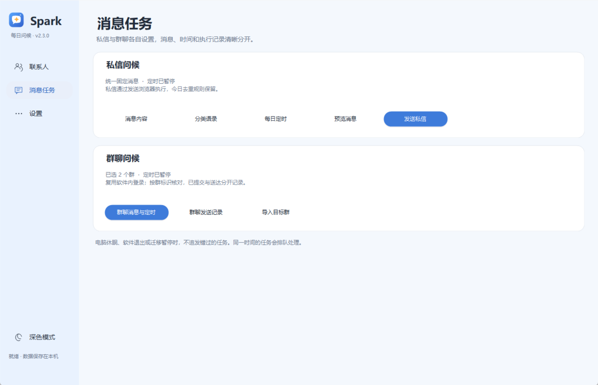
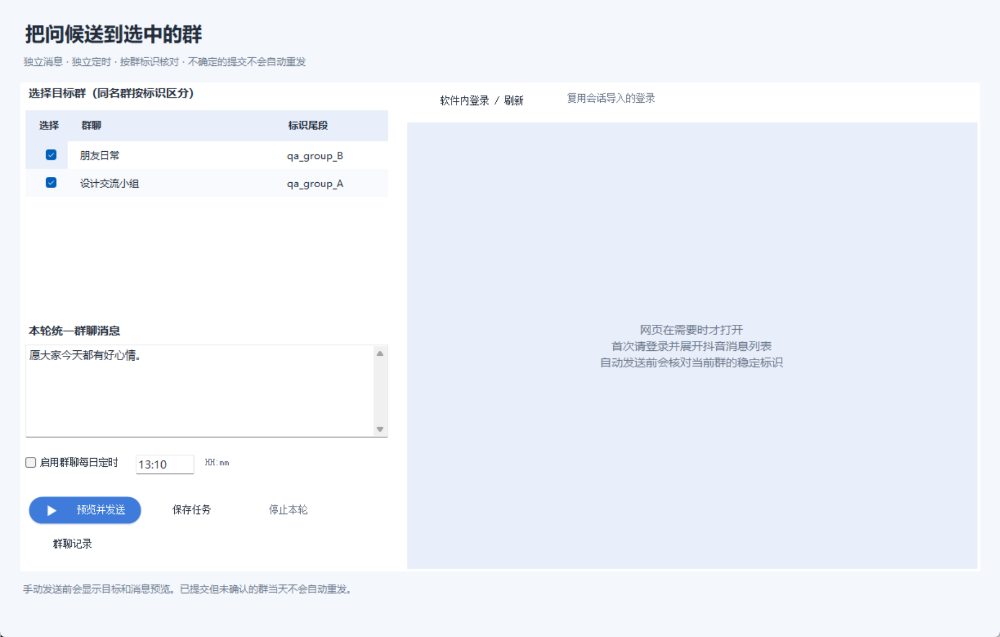
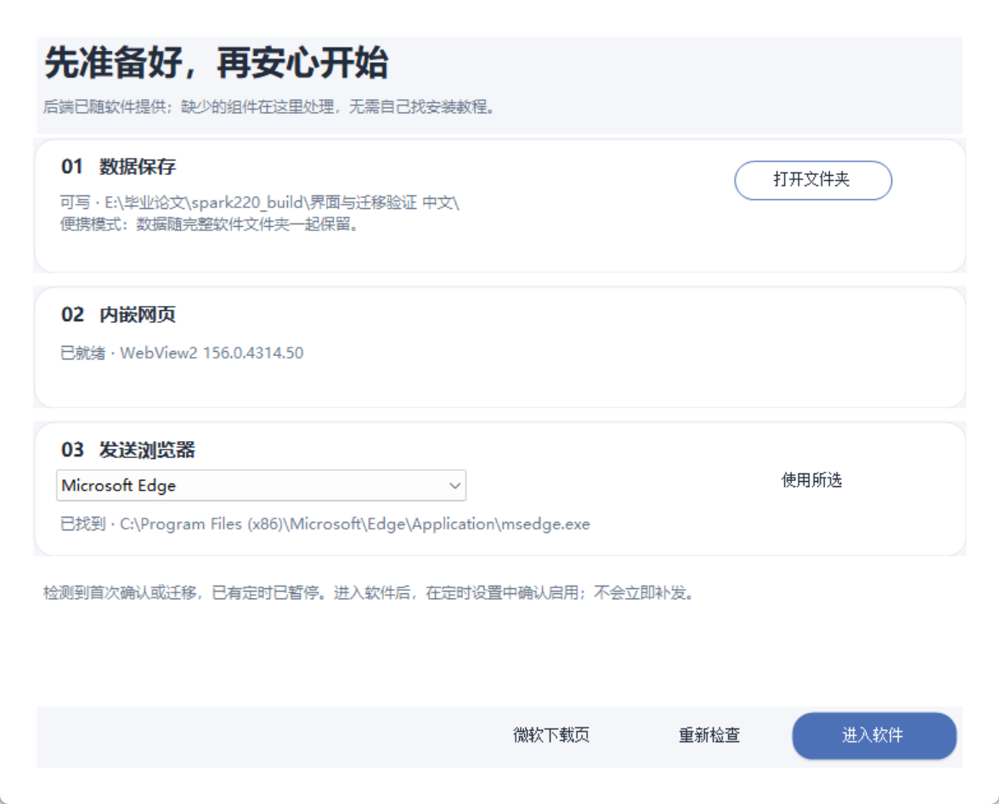

# 抖音续火花 · douyin-spark

Windows 桌面助手，管理私信好友与群聊问候。当前版本 **v2.3.0**。

## 界面预览

浅蓝白聊天软件布局，左侧只留联系人、消息任务、设置三个入口。今日私信 / 今日群聊可切换，群聊采用独立窗口，主界面仍可操作。更新为原创火花气泡图标，保留深色模式。截图均为虚构测试数据。


## 便携版使用

1. 从 [GitHub Releases](https://github.com/kai666yz/douyin-spark/releases/latest) 下载 Windows x64 ZIP，完整解压。
2. 双击 `抖音续火花.exe`，保留旁边的整个 `spark_backend` 文件夹。
   首次启动会显示“环境与数据”。缺少 WebView2 时点击“一键准备”，由包内微软安装器联网安装并复检；无需自己寻找下载文件。已有组件会直接复用。发送浏览器可在该页面选择。
3. 联系人页点击“导入 → 从私信 / 群聊导入”。已有缓存可直接勾选；首次点“登录 / 刷新”，在软件内登录并打开抖音消息列表，再点“读取当前会话”。
4. 勾选私信好友和群聊后导入。群聊在消息任务中独立设置；没有个人主页的私信显示“待补主页”，需核对补齐后才能发送。类型不明的会话需先手动确认。
5. “设置 → 账号与运行环境 → 发送浏览器”中选择已安装的 Edge、Chrome 或夸克，复用旧版发送登录。内嵌网页与传统发送登录彼此独立，不复制 Cookie；首次可能分别需要登录。
6. 核对右侧消息预览，再点“发送全部私信”。该按钮发送所有有效私信好友，不是只发当前选中项；群聊始终排除。新包名单为空，不含作者登录状态或私人记录。

便携包已含独立 Python/Playwright 后端及 WebView2 SDK 组件，无需另装 Python、豆包或下载 Playwright 浏览器内核。需要 Windows 10/11、.NET Framework 4.6.2+（推荐4.8），内嵌导入还需 [Microsoft Edge WebView2 Runtime](https://developer.microsoft.com/microsoft-edge/webview2/)。传统发送需要上述已安装浏览器之一。

旧版迁移时先退出旧程序，保留自己的 `friends.json`、`config.json`、`group_task.json`、`conversations.json`、`conversation_candidates.json`、`startup_state.json`、`conversation_profile`、对应 `browser_profile*` 和 `logs`。不要用下载包的空名单覆盖自己的名单。

### 群聊消息与独立定时

1. 从会话导入中加入目标群，打开“消息任务 → 群聊消息与定时”，或在“今日群聊”点击任务按钮。群聊窗口独立打开，主窗口仍可切换页面。
2. 勾选目标群，填写不超过2000字的群聊消息；同名群按会话标识区分，不凭群名猜测。群聊消息与私信固定消息分开保存。
3. 手动选择“预览并发送”后核对目标及消息；群聊复用会话导入的内嵌登录。首次需要在右侧网页完成登录或安全验证，软件可等待最多3分钟，支持停止本轮。
4. 需要自动执行时，勾选群聊每日定时，填写HH:mm并保存确认。私信与群聊可同时启用各自的定时；相同时间顺序执行，忙时最多排队10分钟，超过则跳过。重启、休眠错过执行窗口不会补发，迁移后两类已有定时均暂停。
5. 发送前验证当前群标识及输入框，已有草稿保持原样。提交前先保存待确认记录；提交阶段中断不自动重试。网页点击/按回车仅记“已提交待核对”，不把它当送达；可在群聊记录中人工核对、标为已送达或未送达、导出CSV。
6. 当天已提交、已确认或不确定的群默认跳过；只有明确核对为未送达后才可手动重试。定位、输入或权限无法验证时停止该群，不绕过验证码或调用私有发送接口。当前读取列表可能不包含未加载历史会话。

今日群聊统计已保存的任务目标及当天实际处理过的群，“已核对”与“待确认”分开显示。私信Python后端继续排除群聊，群聊发送使用独立内嵌网页流程，两类记录互不混入。




验证范围：实际登录群页面已完成只读定位及输入框身份检查，未填写或发送真实消息；本地拦截页面通过按钮/作用域内回车提交、防重、取消和双向排队测试。真实群聊的服务器接收、送达与火花变化尚未验收，不承诺网页提交必然产生火花。

### v2.2 数据目录与定时保护

- 程序目录可写时继续使用便携模式。不可写时，复制可读取的名单、配置、历史和专用profile到 `%LOCALAPPDATA%\douyin-spark\data\<位置标识>`，原文件保留；迁移未完成会报错，不能把空名单当成功。不同程序位置的备用目录隔离。
- 完成回退后继续复用该用户目录，即使原目录权限恢复，也不切回旧数据。前后端共用相同定位规则；后端程序与JS资源仍从软件目录读取。
- “设置 → 环境与数据”显示实际数据目录，可直接打开。移动整个便携目录时保留 `startup_state.json`；跨电脑或账户登录可能需要重新验证。
- 首次升级确认、运行位置或账户环境变化时，已有定时持久暂停。关闭提示或重启都不会自动恢复；在定时设置中“保存启用”后等待下一次时间，错过的任务不立即补发。休眠后错过一分钟执行窗口也跳过；同一天的定时尝试记录在派发前保存，重启不重复触发。
- 仅修复**已经启用**的开机自启路径，未启用时不创建自启项。移动一个只读程序目录后，数据仍保留在原备用目录；请从旧“数据位置”备份个人文件到新位置，不要用空名单覆盖已有文件。
- 独立后端已从Python 3.10.6升级到3.12.14，无需用户安装Python；固定Playwright 1.64.1。系统WebView2由微软Evergreen维护，软件不卸载或擅自替换系统浏览器。实际构建版本记录在包内`runtime-versions.json`。



### 首次下载与系统提示

当前桌面程序尚未进行商业代码签名，部分电脑可能提示未知发布者或阻止启动。请仅从本仓库Releases下载，并核对发布页SHA256与包内`SHA256SUMS.json`。不要为运行软件关闭杀毒软件；不确认来源时不要绕过系统拦截。系统是否提示取决于具体电脑，本地测试无法保证。

包内WebView2引导安装器来自[微软官方分发方案](https://learn.microsoft.com/en-us/microsoft-edge/webview2/concepts/distribution)，已在构建时检查微软数字签名，并固定SHA256；运行时再次校验。点击“一键准备”才会执行，需联网下载实际Runtime；离线电脑可以先使用名单和历史功能，不宣称全离线零依赖。

### 会话导入与登录保留

- 从内嵌消息页面读取已加载会话的名称、类型和稳定标识，不保存聊天正文，不抓取或导出登录 Cookie。
- 在同一软件目录中保留 `conversation_profile`，登录有效时无需重复扫码。上次读取的会话缓存可直接勾选，不启动网页；刷新新会话时才展开网页。
- “读取当前会话”会尝试打开消息并等待读取。已加载的消息面板即使因切换焦点而隐藏，仍可识别其会话元数据；单击复选框即可选择联系人。
- 读取失败会提示原因及下一步，计数诊断保存在 `logs/conversation_read.log`，其中不包含联系人名称、标识、聊天正文或 Cookie。
- 只展示可验证标识或个人主页的条目，不靠昵称猜测身份。相同群名、不同会话标识分别保留。
- 当前读取结果不代表所有历史会话。页面未加载、没有可识别标识、接口/DOM变化时，可能只能读取部分会话；可在消息页继续加载，或使用“关注导入”和手动添加。
- 类型不明的条目需用户确认；私信无主页时仅管理；群聊使用独立任务，不进入私信发送后端。右键联系人可移出本软件名单，不会解除抖音好友或退出群聊。
- 右侧语录仅为示例，固定消息是本轮统一设置。查看、切换联系人、读取会话和预览都不会自动发送。

### v2.0 关注列表导入

- 软件的浏览器 profile 与日常浏览器相互独立。请在软件弹出的窗口中登录，最多等待3分钟；必要时手动打开自己的关注列表。
- 读取窗口显示阶段及已发现人数，支持取消；关闭读取窗口也会请求取消，等待当前浏览器操作结束。重复点击不会重复启动导入。
- 仅明确的成功接口、结束标记与总数一致时才标为完整；网页链接回退和无法确认总数的结果标为“部分”，需用户确认后再勾选。
- 区分完整、部分、已确认空列表、未登录、失败和取消；0人不会弹空勾选窗。只有接口明确证明0人时才显示“暂无关注”。
- 失败、空列表、部分结果和取消均保留原关注缓存。完整结果仅更新关注缓存；实际好友名单只在点击“导入选中”时追加去重。
- 失败窗口提供重试、手动添加和本次诊断；诊断摘要位于 `logs/following_import.log`，按现有文本日志策略轮换。
- 网站变动、权限限制或接口没有总数时可能只能获得部分数据；软件不会将不确定结果描述为完整。

## 功能与入口

| 功能 | 入口与行为 |
|---|---|
| 添加好友 | 联系人 → 导入：从私信/群聊导入、关注列表或手动添加 |
| 联系人 | 全部 / 私信 / 群聊筛选、搜索、当前联系人详情、消息预览和独立发送记录 |
| 今日概览 | 今日私信 / 今日群聊分别查看处理数与定时；群聊提交待核对不算成功 |
| 外观 | 浅蓝白 / 深色自动保存；三页导航、原创火花气泡图标 |
| 好友状态 | 查看今天的状态；缺失主页显示“待补”，不会猜测链接 |
| 语录管理 | 消息任务 → 私信问候 → 分类语录：分类、自定义与节日优先 |
| 固定消息 | 消息任务 → 私信问候 → 消息内容；留空恢复语录池，私信手动和定时共用 |
| 定时与自启 | 程序运行且电脑唤醒时按设定时间执行；开机自启使用 `--minimized` |
| 托盘 | 最小化或关闭窗口后继续在托盘运行；右键托盘选择“退出” |
| 历史 | 联系人右侧查看私信记录；设置中导出/清理私信历史；群聊任务中独立核对和导出 |
| 检查更新 | 设置 → 外观与软件；查询GitHub Releases，确认后打开官方下载页 |

固定消息绕过语录池和“最近7天句子不重复”，**仍保留当天好友去重**。无需修改句子库，也无需删除日志。历史清理会先备份并保留今天的记录，避免清理历史后重复发送。

## 命令行

在解压目录打开 PowerShell：

```powershell
# 仅预览固定消息；不启动浏览器，不发送。
.\spark_backend\spark_backend.exe --dry-run --message "嘎嘎地拉下"

# 真正发送前，先核对好友和消息。省略 --dry-run 才会执行发送。
.\spark_backend\spark_backend.exe --message "自己填写的问候消息"

# 打开浏览器进行登录检查；不会发送消息。
.\spark_backend\spark_backend.exe --selftest

# 仅用本地 HTML 检查浏览器运行环境，不访问抖音。
.\spark_backend\spark_backend.exe --runtime-check

# 导出历史，不执行发送。
.\spark_backend\spark_backend.exe --export-history ".\发送历史.csv"
```

源码运行时将上面的后端命令改为 `.\.venv\Scripts\python.exe .\douyin_spark.py`，参数相同。`--friend` 可筛选好友；`--force` 明确忽略当天好友去重，用于人工决定的重发。`--cancel-file PATH` 指定的文件出现后会停止后续处理。

## 稳定性与数据保护

- 好友名单使用 JSON 读写，保存时原子替换并保留 `.bak`，支持 BOM 与尾逗号。损坏文件会报错并保留原文。
- CSV 活动日志保留最近14天，其余按月放入 `logs/archive/spark_log`。语录去重和导出仍读取归档。
- 文本日志每份最多约2 MiB，再轮换至 `.1`～`.5`。运行输出在下一次启动时重置。
- 检测到验证码时暂停，提示在浏览器手动处理，最多等待5分钟；页面提示操作频繁时停止任务。
- 未提交失败最多额外重试2次，分别退避2、4秒并重建页面；不切换 UA 或自动解验证码。
- 按下发送键前写入待确认记录；结果不确定时保留 `UNCONFIRMED`，不会自动重发，当天默认跳过该好友。
- 任务锁防止多个发送/导入任务占用同一目录。网站变化、网络及账号状态仍可能影响识别；应核对异常记录。

`friends.json`、配置、关注列表、浏览器登录状态、日志、备份和运行环境均在 `.gitignore` 中。自定义语录存放在句子库中，提交修改前须自行检查；发布脚本会清空“自定义”分类。

## 从源码构建

安装 Python 3.10+ 并加入 PATH，在仓库目录运行：

```powershell
powershell -ExecutionPolicy Bypass -File .\setup.ps1
powershell -ExecutionPolicy Bypass -File .\build.ps1
.\抖音续火花.exe
```

界面先寻找随包独立后端；未找到时依次使用 `.venv`、`DOUYIN_SPARK_PYTHON` 指定路径、便携 `runtime`、系统 PATH，最后才兼容查找当前用户的豆包沙箱。不存在固定用户名或沙箱版本路径。

生成可分发 ZIP：

```powershell
powershell -ExecutionPolicy Bypass -File .\package.ps1
```

输出在 `dist/douyin-spark-v2.1.1-windows-x64.zip`。使用 PyInstaller 文件夹模式，附带必要依赖与许可证；不直接复制本机 `.venv`。构建时从 NuGet 下载固定版本 WebView2 SDK，并校验 SHA-256；不把本机 Runtime 或登录文件打包。

## 源码结构

```text
src/app.cs              主窗口、定时与运行状态
src/FriendsForm.cs      好友管理与关注导入
src/FollowingImport.cs  登录引导、可取消读取、结果校验与诊断
src/Storage.cs          JSON、CSV与文本日志
src/BackendLauncher.cs  后端选择与进程启动
src/DesktopFeatures.cs 托盘、固定消息、历史和更新检查
src/Theme.cs            Kitty绘制
src/Appearance.cs       明暗配色、圆角与矢量图标
src/MainView.cs         仪表盘布局与数据刷新
src/ChatWorkspace.cs   三栏联系人工作台、搜索筛选与详情
src/RosterList.cs      联系人列表与头像占位
src/RosterModel.cs     好友/群聊统一展示、发送隔离
src/Conversations.cs   会话标识校验、合并及元数据解析
src/ConversationImport.cs 内嵌消息页、缓存与勾选导入
src/DashboardCards.cs  概览和空状态卡片
src/TodaySummary.cs    今日去重统计
src/SparkProgress.cs    进度与完成动画
src/Controls.cs         其他自绘控件
douyin_spark.py         消息流程与命令行参数
fetch_following.py      关注列表读取
spark_support.py       路径、归档、任务锁、人工验证支持
spark_backend.py       独立后端入口
tests/                 离线回归测试
tools/package_release.py 发布打包
```

离线测试：`python -m unittest discover -s tests -p "test_*.py"`。C#存储测试见 `tests/StorageTests.cs`，需与 `src/Storage.cs` 一同编译为控制台程序。

浏览器离线烟测：`python tools/verify_following_browser.py`，需要本机 Edge。全部网页请求由测试拦截，不登录真实账号、不发送消息。

会话 DOM 离线烟测：`python tools/verify_conversation_dom.py`。会话和名单隔离测试见 `tests/ConversationTests.cs`，编译后引用主程序程序集运行。

## 许可证

原创代码采用 [MIT](LICENSE)。第三方依赖按各自许可证分发；Hello Kitty 等名称、形象及相关素材权利归各自权利人，MIT 不授予这些权利。本项目与抖音及相关品牌无隶属关系。请仅向愿意接收消息的好友使用。

本版已进行离线测试、界面渲染及独立后端本地浏览器检查；未进行真实消息发送或在线验证码验证。变更见 [CHANGELOG](CHANGELOG.md)。
